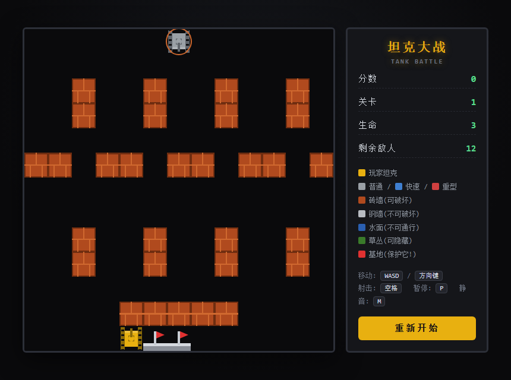

# 🎮 坦克大战 · Tank Battle

经典 FC《坦克大战》（Battle City）风格的网页小游戏，使用纯 **HTML + CSS + JavaScript（Canvas）** 实现。零依赖、无框架，单个 `index.html` 文件即可运行。

> 🕹️ 在线试玩：**https://lucyljy.github.io/tank-battle/**



## ✨ 特性

- 完整游戏循环：移动、射击、碰撞检测、敌人 AI、关卡推进
- 3 种敌军坦克：**普通 / 快速 / 重型**，各有不同速度与血量
- 4 种地形：砖墙（可破坏）、钢墙（不可破坏）、水面（不可通行）、草丛（可隐蔽）
- 需保护的 **基地旗帜**：被击中即游戏失败
- 4 种道具：⭐ 火力升级、🛡️ 护盾、❤️ 生命、💣 炸弹
- 6 关以上：前 3 关为手工设计地图，后续关卡自动生成、难度递增
- Web Audio 音效、记分系统、暂停 / 静音
- 键盘操作，支持方向键与 WASD

## 🕹️ 操作

| 按键 | 功能 |
| --- | --- |
| `W` / `A` / `S` / `D` 或 方向键 | 移动 |
| `空格` | 射击 |
| `P` | 暂停 / 继续 |
| `M` | 静音 |
| `Enter` | 开始 / 下一关 |

## 🧱 地形

| 地形 | 说明 |
| --- | --- |
| 🟫 砖墙 | 可被子弹摧毁，也是基地的天然屏障 |
| ⬜ 钢墙 | 无法破坏（火力满级后可摧毁） |
| 🟦 水面 | 坦克无法通行，但子弹可以飞过 |
| 🟩 草丛 | 可隐藏坦克 |
| 🚩 基地 | 被任何子弹击中都会游戏失败 |

## ⭐ 道具

由闪烁的红色敌人掉落，驾驶坦克压过即可拾取：

| 道具 | 效果 |
| --- | --- |
| ⭐ 星星 | 提升火力等级（更快 / 更多子弹 / 摧毁钢墙） |
| 🛡️ 护盾 | 短时间内无敌 |
| ❤️ 生命 | 增加一条命 |
| 💣 炸弹 | 立即消灭场上所有敌人 |

## 📈 计分与敌人

| 敌人 | 分数 | 特点 |
| --- | --- | --- |
| 普通 | 100 | 速度、血量适中 |
| 快速 | 200 | 移动更快 |
| 重型 | 300 | 需要击中 3 次才被摧毁 |

## 🚀 运行

### 在线试玩

本仓库已启用 GitHub Pages，直接访问：

```
https://lucyljy.github.io/tank-battle/
```

### 本地运行

方式一：直接用浏览器打开 `index.html`。

方式二（本地静态服务器）：

```bash
python -m http.server 8000
# 浏览器访问 http://localhost:8000
```

方式三（带自动开始的直链，无需点击开始按钮）：

```
index.html?play=1
```

## 📁 项目结构

```
tank-battle/
├── index.html      # 游戏主文件（HTML + CSS + JS 全部内联）
├── screenshot.png  # 游戏截图
└── README.md
```

## 🛠️ 技术实现

- **地图**：13 × 13 网格，每格 40px，砖墙 / 钢墙 / 水面 / 草丛 / 基地五种地形
- **移动**：像素级移动 + 网格对齐（坦克转弯时对齐到车道）
- **碰撞检测**：AABB 包围盒与地图瓦片、坦克、子弹之间的碰撞
- **游戏循环**：`requestAnimationFrame` + 增量时间步长，保证不同帧率下速度一致
- **音效**：Web Audio API 实时合成，无需任何音频文件
- **渲染**：Canvas 2D，草丛作为半透明上层遮挡坦克

## 📄 许可证

[MIT License](LICENSE)
